# happy_system

A WebGL engine and a creature system that run in the browser with **no build step and no C++ toolchain**. The engine's C++ (geometry, physics, IK, creature rig, terrain) is shipped precompiled as two WebAssembly modules; everything else is plain JavaScript that a small dev server bundles on the fly.

It includes:

* a deferred renderer with cascaded shadows and an atmosphere,
* a physics world (bodies, joints, rays, ragdolls),
* GPU particles,
* a procedural terrain, vegetation and city/road/bridge generator,
* a creature system: 159 ready-made creature files (people, animals, insects, robots, vehicles), few gait styles, actions, and a behaviour-block AI.

## Demos

Start the server (see [Run](#run)) and open **http://localhost:8099/demos/index.html** for the gallery. Each demo is also a plain page you can open directly.

| | |
|---|---|
| [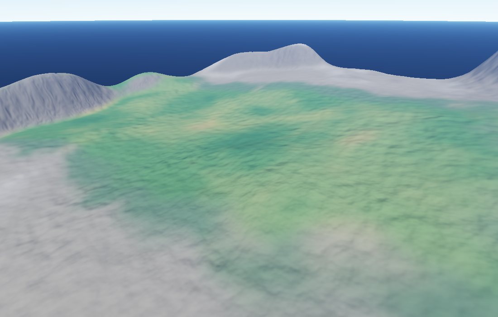](demos/terrain_demo.html) **[Procedural terrain](demos/terrain_demo.html)**<br>Heightmap island, 20 ground materials, sea, sky, cascaded shadows, 20 presets. [`?preset=alps`](demos/terrain_demo.html?preset=alps&seed=2) | [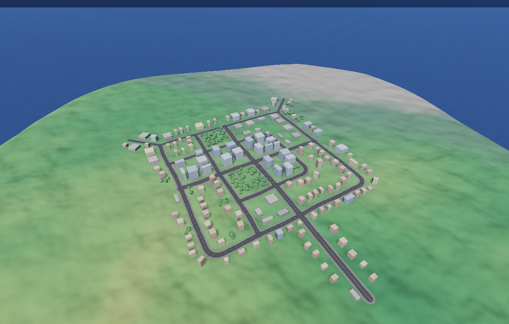](demos/city_demo.html) **[City on terrain](demos/city_demo.html)**<br>Generated streets, lots and buildings on graded ground. Layouts: grid, organic, radial, suburb, village. [`?layout=radial`](demos/city_demo.html?layout=radial&seed=5) |
| [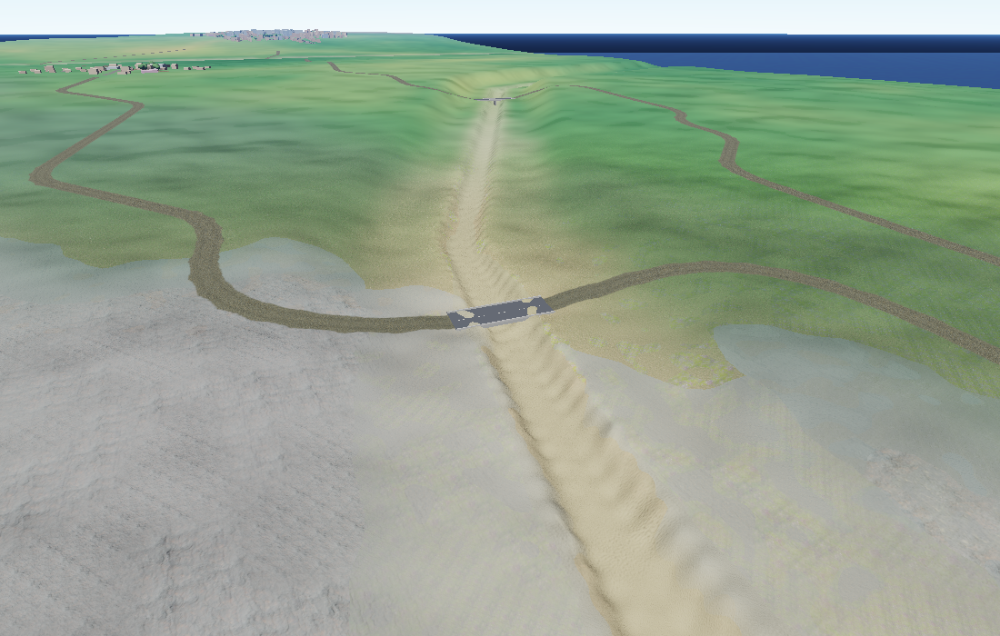](demos/city_demo.html?places=3&seed=3&look=784,538&cam=25,-30,150) **[Bridges](demos/city_demo.html?places=3&seed=3&look=784,538&cam=25,-30,150)**<br>Places joined by roads; bridge decks carry them over rivers and gorges. | [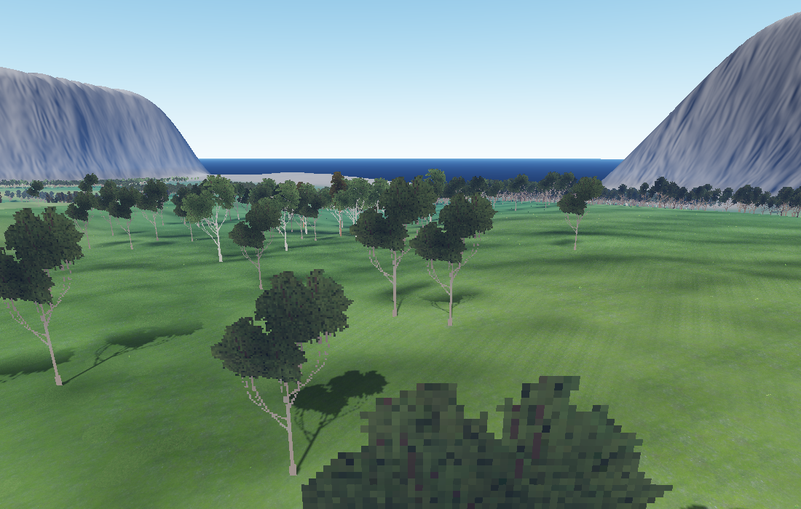](demos/vegetation_demo.html) **[Trees and plants](demos/vegetation_demo.html)**<br>About 46,000 generated trees and plants, billboards at a distance and meshes near. |
| [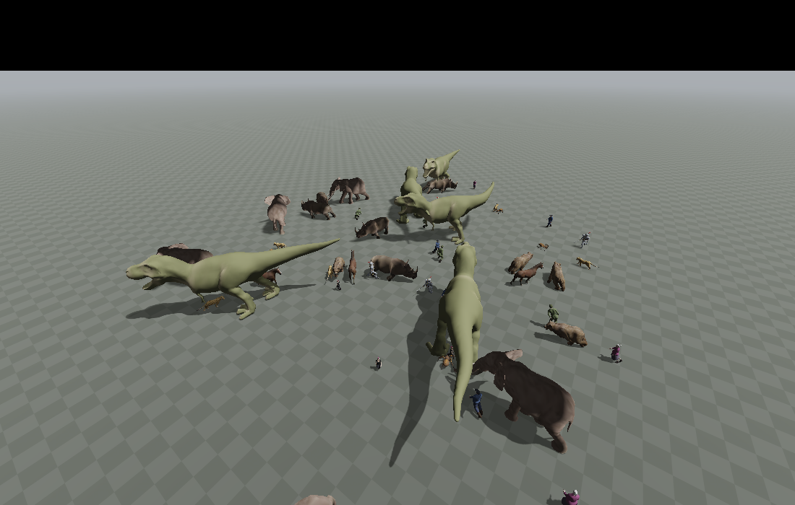](demos/creatures_demo.html) **[A crowd of creatures](demos/creatures_demo.html)**<br>60 creatures of 12 kinds wandering on a lit floor. | [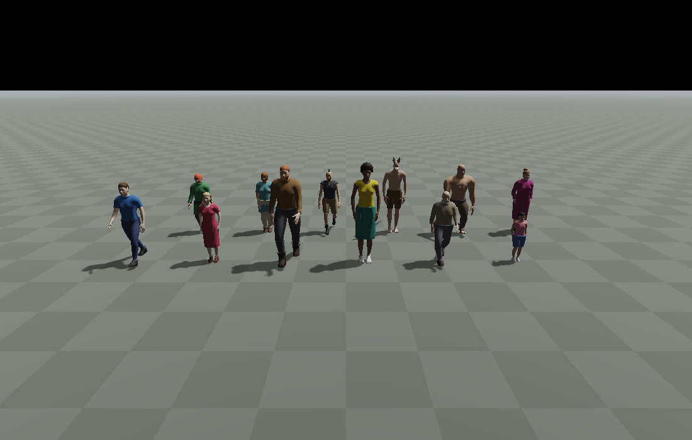](demos/humans_demo.html) **[Procedural people](demos/humans_demo.html)**<br>Builds, ages, tones, clothes, hair and beards. |
| [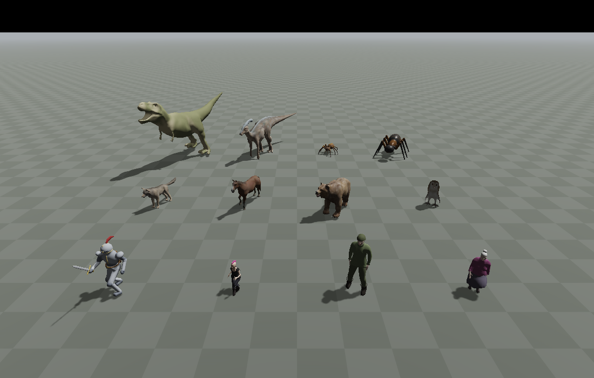](demos/gaits_actions_demo.html) **[Gaits and actions](demos/gaits_actions_demo.html)**<br>12 bodies switching between gait styles and playing actions. | [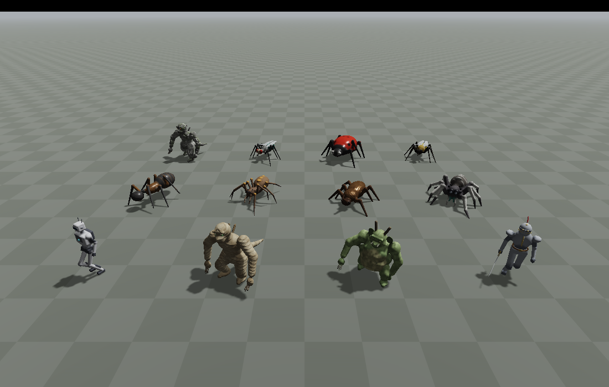](demos/sdf_demo.html) **[SDF creatures](demos/sdf_demo.html)**<br>12 creatures meshed from signed-distance definitions, with texture maps. [wireframe](demos/sdf_demo.html?wire=1&files=android,ladybird&cols=2&size=1.7&dist=3.2) |
| [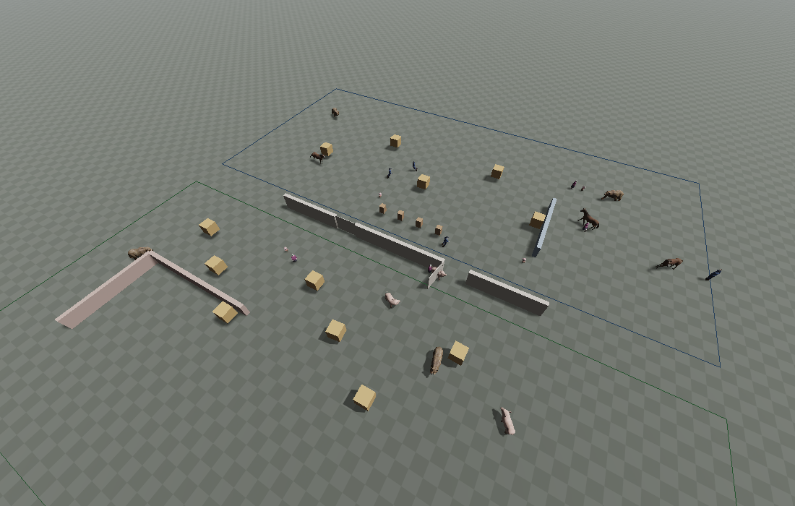](demos/ai_demo.html) **[Creatures living by their AI](demos/ai_demo.html)**<br>24 people and animals wander, avoid, and flee a scare. | [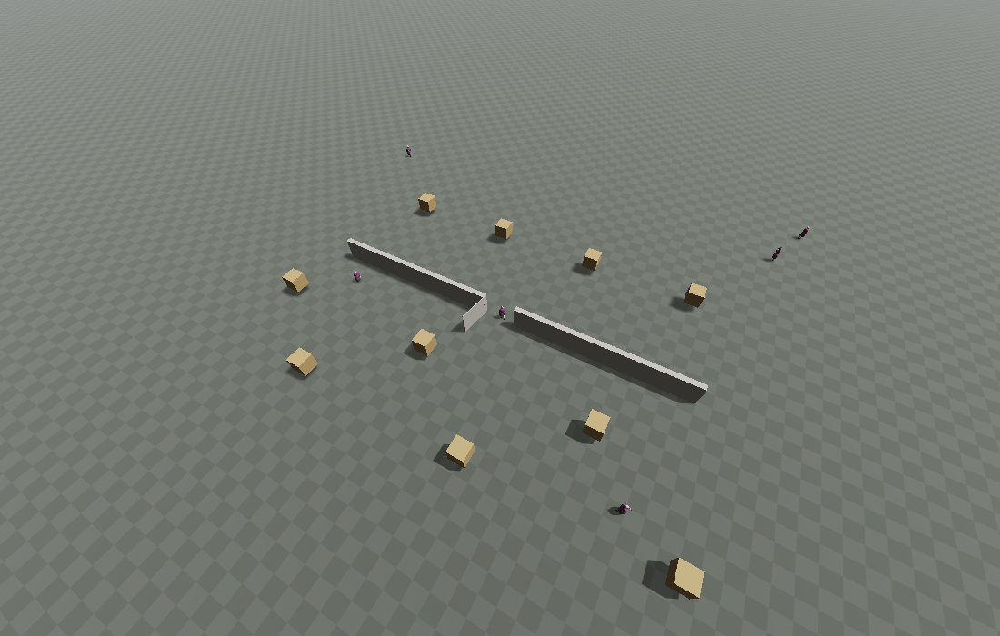](demos/ai_blocks_demo.html) **[The AI blocks](demos/ai_blocks_demo.html)**<br>The 35 behaviour blocks and 19 ready-made minds. |
| [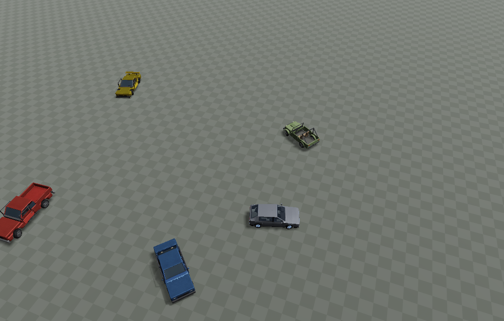](demos/vehicles_demo.html) **[Vehicles](demos/vehicles_demo.html)**<br>Five cars on a circular track with suspension, engine and gears. | [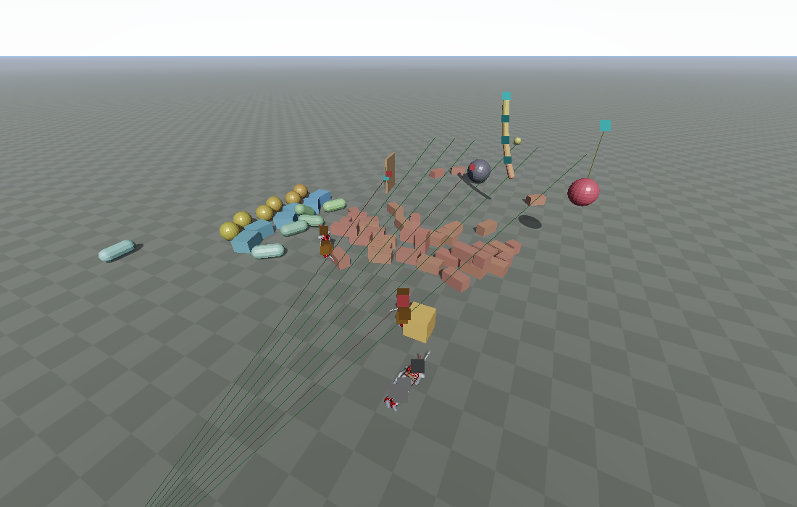](demos/physics_demo.html) **[Physics](demos/physics_demo.html)**<br>Falling bodies, a brick wall, joints, a hinged door, ragdolls. |
| [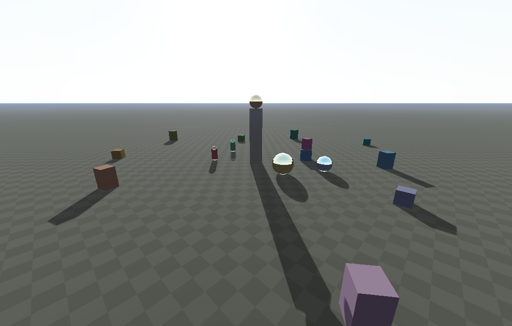](demos/render_demo.html) **[Deferred rendering](demos/render_demo.html)**<br>Deferred shading, cascaded shadows, atmosphere, a movable sun. | [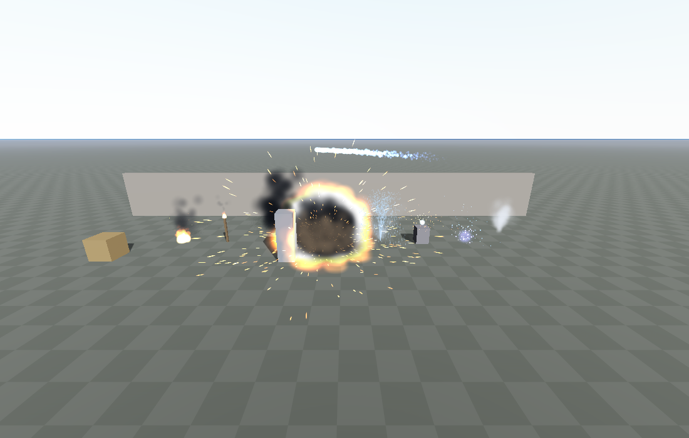](demos/particles_demo.html) **[GPU particles](demos/particles_demo.html)**<br>Fire, smoke, fountain, welding, magic, explosions: ~6,000 particles. |

There is also a minimal creature page at [system/system_demo.html](system/system_demo.html) (a biped and a person of the lite human walking).

Demos take URL parameters (for example `?seed=`, `?preset=`, `?cam=`); the gallery page lists them for each demo.

## Run

You need [Node.js](https://nodejs.org) and a browser with WebGL2 and WebAssembly. There is nothing to install or build.

```
node packing.js -serve default
```

then open <http://localhost:8099/demos/index.html>.

Server options:

| option | meaning |
|---|---|
| `-serve` / `-serve default` | listen on `0.0.0.0:8099` |
| `-serve 8100` | another port |
| `-serve 127.0.0.1:8100` or `-serve :8100` | a host and/or a port |
| `-serve 0` | any free port (the server prints which) |
| `-port 8100`, `-host 127.0.0.1` | override just the port or the host |
| `-root <folder>` | the folder to serve (default: the current one) |

Run it from this folder so that `/demos/...`, `/system/...` and `/wasm/...` resolve. Opening the `.html` files straight from disk will not work (the worker and the `.wasm` files must be fetched over http).

## What is in this repository

| path | what it is |
|---|---|
| `engine.js` | the engine's page side: scene, GL context, the command link to the worker |
| `worker.js` | the engine's worker side: physics, cameras, transforms, IK, terrain |
| `rendering.js`, `deffered_rendering_v2.js`, `shaders.js` | the deferred renderer and its shaders |
| `geometries.js`, `objects.js`, `math.js`, `float_views.js`, `land.js` | geometry generators, scene objects, math, typed-array views, land/terrain helpers |
| `physics_system.js` | the physics world's page API |
| `particles/` | GPU particles and the ready-made effects (fire, smoke, steam, ...) |
| `vegi/` | tree, trunk and plant presets, vegetation rules, procedural textures |
| `debug.js` | debugging helpers |
| `packing.js` | the dev server and bundler: serves the pages, resolves the `import`/macro directives and bundles the JS for a page |
| `wasm/` | the two precompiled modules and their manifest (below) |
| `wasm_runtime.js` | loads the modules: `happy_wasm("main" \| "worker")` |
| `system/` | the creature system (below) |
| `demos/` | the demo pages, their scripts and `screenshots/` |

### `wasm/`

| file | what it is |
|---|---|
| `happy_main.wasm` | the page's module: geometry (planes, cubes, spheres, capsules ...), noise, tree and plant generators |
| `happy_worker.wasm` | the worker's module: transforms, cameras, physics, IK, the creature system (rig, body, world), the terrain heightmap |
| `manifest.json` | sizes, sha256, imports/exports of both modules and the engine's command constants |

Both modules are a superset: they hold everything the engine offers, whichever parts a page uses. A page that does not use creatures, terrain or vegetation never calls into those parts. The worker runs as a Blob, so `engine.js` prefixes its source with the url of the wasm folder (`<origin>/wasm/` unless the page sets `window.HAPPY_WASM_BASE` before the engine starts).

### `system/`: the creature system

Every feature is an API of `engine.system`; all the data it reads lives in one file, `system.bin`.

| path | what it is |
|---|---|
| `system.js`, `kernel.js`, `body.js`, `species.js`, `runtime.js`, `pure.js` | the system's page side, the creature as data, body parts, species and the per-feature APIs, drawing and the worker link, and the pure (engine-free) modules |
| `mesher.js`, `maps.js`, `data.js` | the SDF mesher, texture-map baking, and the `system.bin` container codec |
| `human.js` | the "lite human": builds, clothes, hair, people as data |
| `creature_file.js` | the creature file format, a JS file returning `{ name, family, nav, body, abilities, ... }` |
| `world.js`, `worldgen.js`, `environment.js`, `ground.js`, `eras.js` | the world builder and runtime, terrain generation, ground materials, era style sheets |
| `city.js`, `road_field.js`, `road_mesh.js`, `grade.js`, `bridge.js`, `structures.js`, `elements.js` | the city/road/bridge generator and the things it places |
| `creatures/` | 159 creature files (people, mammals, birds, insects, dinosaurs, robots, vehicles) |
| `system.bin` | 8 MB data pack: 18 gait libraries, 27 action sets, the AI's blocks, the lite human model |

Further reading:

* [system/SYSTEM.md](system/SYSTEM.md): the architecture of the creature system, file by file
* [system/system.bin.md](system/system.bin.md): what is inside `system.bin` and how to read it
* [system/MOTION.md](system/MOTION.md): an index of every action and gait style, by type and by number of legs
* [system/CITY.md](system/CITY.md): the city generator's options, layouts and pipeline

## Limits of this repository

The C++ source is not included; the wasm modules are build products.

* You cannot change the engine's C++ here.
* You cannot add a new command constant (`consts$({ CMD_X: ... })`): the number of each constant is fixed in the wasm. Existing ones are listed in `wasm/manifest.json`.
* There is no in-browser compiler; pages are bundled from JavaScript only.

Everything in JavaScript (the renderer, the system, the generators, the demos, the creature files) can be edited freely: reload the page and the server re-bundles it.
